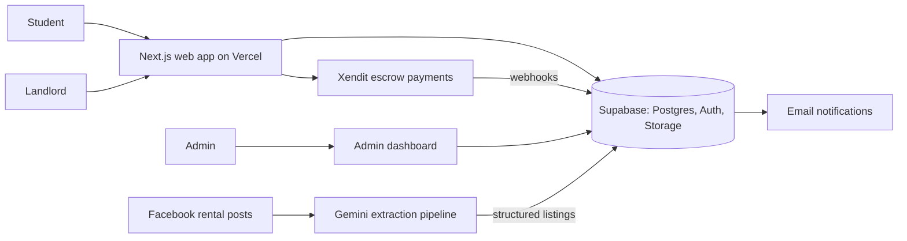

# UniDorms.ph
**Dorms near your campus, booked online.** A two-sided student-housing marketplace for the Philippines that connects university students with ID-verified landlords.

🌐 [unidorms.ph](https://unidorms.ph) · **Status:** Launching soon (waitlist open, launch pending business registration)

> 🔒 **Source code is private.** This repo is a showcase of the product, its features and its architecture.

<!-- screenshot here: landing page -->
<!-- Loom walkthrough here -->

## Who it's for
- **Students** looking for dorms near DLSU, Ateneo, UP, UST and 12+ other campuses.
- **Landlords** who want to list for free with 0% commission.

## Key features
- **Listings and search** for dorms near campus
- **Landlord ID verification** and host reputation
- **Escrow payments via Xendit**: the first payment claims the room, other payments refund automatically, and payouts need admin approval
- **Gemini listing-extraction pipeline** that turns messy Facebook rental posts into clean, structured listings
- **Admin dashboard** for verification, listings and payout approvals
- **Email notifications**
- Refundable platform fee for students and a 24-hour move-in guarantee
- Rate limits and automated tests covering logins, payments and listings

<!-- screenshot here: listing page -->
<!-- screenshot here: admin dashboard -->

## Architecture (high level)

## Stack
Next.js · React · Tailwind · Supabase (Postgres, Auth, Storage) · Vercel · Xendit · Gemini (listing extraction) · Built with Claude Code

## Build notes
Built solo in about four months. I handled scope, specs, edge cases (like two students paying for the same room) and testing, and Claude wrote the code.

## Contact
[brentbuilds.dev@gmail.com](mailto:brentbuilds.dev@gmail.com) · [LinkedIn](https://www.linkedin.com/in/patrick-brent-santiago)
